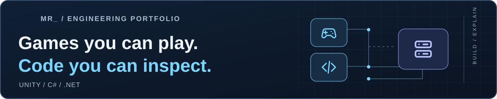

  <picture>
    <source media="(max-width: 640px)" srcset="docs/assets/profile-banner-mobile.svg">
    
  </picture>

<h1 align="center">Michael (Michał) Rusinek</h1>

<strong>Software &amp; Game Systems Engineer · C++20 / D3D12 · Unity 6 · .NET 10</strong>

  I build real-time systems and backend prototypes, then document how they work and what was measured.
   <strong>Measure. Then claim.</strong>

  
  
  
  
  

  <a href="https://github.com/Mr444-dev">Primary GitHub profile</a> ·
  <a href="https://gitlab.com/Mr444-dev">GitLab</a> ·
  <a href="https://www.youtube.com/@MichaelRusinek">YouTube</a> ·
  <a href="https://x.com/mrusinek_dev">X</a> ·
  <a href="https://www.linkedin.com/in/michaelrusinek/">LinkedIn</a>

  <strong>Open to Software Engineer, Unity Developer and C#/.NET roles</strong> 
  Wrocław, Poland · <a href="https://portfolio.michaelrusinek.workers.dev/cv/">View both CV editions</a>

---

  <a href="#mr-work">Selected work</a> ·
  <a href="#mr-practice">Engineering practice</a> ·
  <a href="#mr-more">More to explore</a> ·
  <a href="#mr-contact">Contact</a>

<h2 align="center"> Selected work</h2>

Six public repositories pinned on this profile, each linked to its portfolio case study and source.

| Project | Stack | Portfolio X-Ray | Repository |
| --- | --- | --- | --- |
| **Blackbox** | .NET 10, PostgreSQL, Kafka | [Backend case study](https://portfolio.michaelrusinek.workers.dev/notes/transactional-outbox/) | [Source](https://github.com/Mr444-dev/blackbox) |
| **Arcglass Engine** | C++20, Direct3D 12, HLSL | [Engine case study](https://portfolio.michaelrusinek.workers.dev/work/arcglass-engine/) | [Source](https://github.com/Mr444-dev/ArcglassEngine) |
| **ProcureScope** | Python, PostgreSQL, dbt, Airflow | [Data pipeline case study](https://portfolio.michaelrusinek.workers.dev/work/procurescope/) | [Source](https://github.com/Mr444-dev/ProcureScope) |
| **QuantumBody** | C++20, rigid-body physics, CTest | [Physics case study](https://portfolio.michaelrusinek.workers.dev/work/quantum-body/) | [Source](https://github.com/Mr444-dev/QuantumBody) |
| **Blackhole Compute Simulation** | Unity 6, HLSL, GPU Compute, Burst | [Simulation X-Ray](https://portfolio.michaelrusinek.workers.dev/work/blackhole-simulation/) | [Source](https://github.com/Mr444-dev/unity-blackhole-compute-sim) |
| **PathDrawer** | Unity 6, C#, Burst, geometry | [Tool case study](https://portfolio.michaelrusinek.workers.dev/work/pathdrawer/) | [Source](https://github.com/Mr444-dev/unity-trajectory-pathdrawer) |

### Blackbox: delivery and duplicate handling

The .NET 10 prototype combines an ASP.NET Core API, PostgreSQL workflow state, a transactional Outbox, Kafka publication and an Inbox projection. The Inbox uses a stable domain EventId and a unique PostgreSQL (consumer_name, message_id) index to avoid applying a duplicate projection update after redelivery. Kafka delivery remains at least once; this is not an exactly-once delivery claim.

### Blackhole: GPU simulation and WebGL fallback

The Unity 6 prototype includes a 1920 by 1080 Game View capture, a tidal disruption event and a WebGL path using CPU Burst with dynamic-mesh rendering at 25,000 particles. Its public benchmark records six CPU Burst and GPU Compute cases on an i3-13100F and GTX 1660 SUPER, with 30 warm-up and 120 measured Editor frames. Another Unity project was running during capture, so whole-frame times include concurrent workload. GPU dispatch values measure CPU command submission, not GPU execution.

### PathDrawer: measured geometry pipeline

PathDrawer includes iterative Ramer-Douglas-Peucker simplification, centripetal Catmull-Rom arc-length resampling, batched terrain queries and Burst ribbon generation. The checked-in Editor report uses 30 measured samples after Burst warm-up on an Intel Core i3-13100F.

| Input points | Total median | Total P95 |
| ---: | ---: | ---: |
| 100 | 256.8 µs | 276.5 µs |
| 500 | 1.854 ms | 2.187 ms |
| 2,000 | 7.803 ms | 9.430 ms |

## Why both GitHub and GitLab?

GitHub is my primary surface for public collaboration and source history. I mirror selected flagship repositories to GitLab so GitLab CI pipelines can provide an additional verification path alongside GitHub Actions.

<h2 align="center"> More to explore</h2>

- [**Humanity’s Last Stand**](https://portfolio.michaelrusinek.workers.dev/work/humanitys-last-stand/) is a released two-person Android game. My teammate and I built it from the ground up; my contribution was game design and programming as part of the team. The Google Play listing displays a rounded 1K+ downloads badge, not an exact or individual result.
- [**BOHEMIA-ALIFE**](https://github.com/Mr444-dev/BOHEMIA-ALIFE) is a public C++20 town simulation with a native Win32 viewer and CRYENGINE 5.7 adapter source. The standalone viewer and CTest suite are the runnable verified path; the CRYENGINE adapter is not yet verified as a runnable Sandbox plugin.
- [**Flying AI Swarm walkthrough**](https://portfolio.michaelrusinek.workers.dev/work/flying-ai-swarm/) documents a Unity Jobs and Burst prototype. Its source repository is private, so this is a source-derived portfolio walkthrough rather than a public code sample.
- Unreal Engine 5.8 and Unity DOTS are areas I am developing further; there is not currently a public flagship repository for either.

<h2 align="center"> Engineering practice</h2>

C# · .NET 10 · Unity 6 · C++20 · Direct3D 12 · HLSL · PostgreSQL · Kafka · Python · Docker Compose · CMake · xUnit · CTest · Playwright · GitHub Actions · GitLab CI

The case studies separate implemented behavior, test evidence, local measurements and remaining limits. Source links appear where the repository is public.

<h2 align="center">Let’s build something useful.</h2>

  <strong>Open to a conversation about software, game systems and engineering work.</strong> 
  <a href="mailto:michael.rusinek.contact@gmail.com">michael.rusinek.contact@gmail.com</a>

<a href="#mr-top">↑ Back to top</a>

