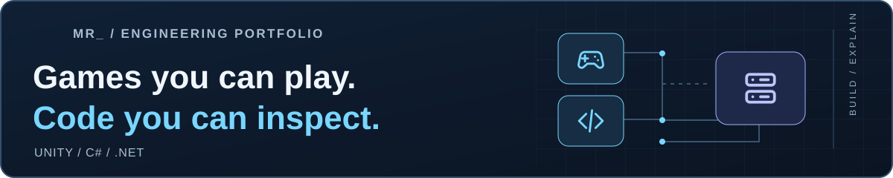
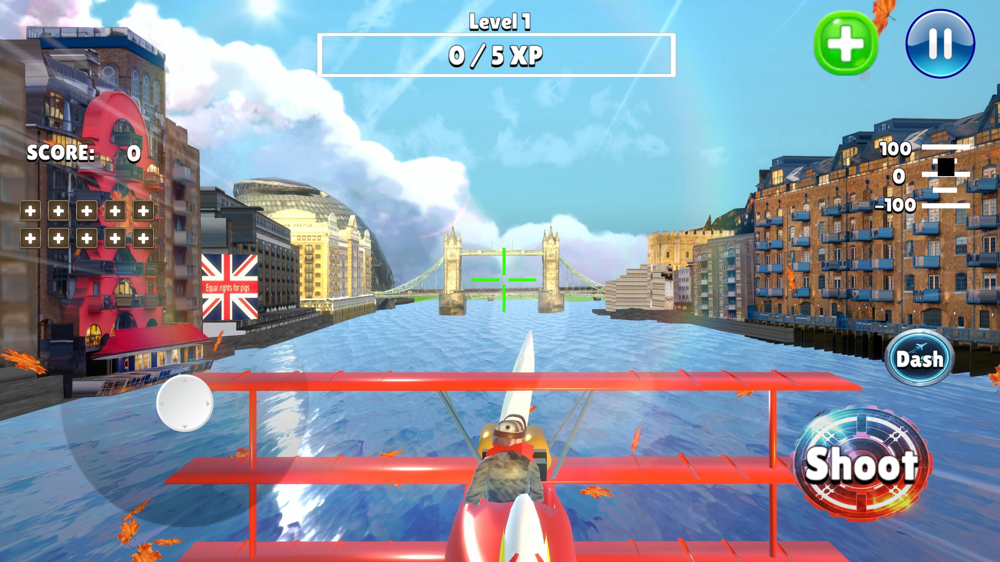

  <picture>
    <source media="(max-width: 640px)" srcset="docs/assets/profile-banner-mobile.svg">
    
  </picture>

<h1 align="center">Michael Rusinek</h1>

<strong>Software Engineer · Unity &amp; .NET</strong>

  I build gameplay systems in <strong>Unity / C#</strong> and backend prototypes with <strong>.NET</strong>. 
  Co-created and shipped <strong>Humanity’s Last Stand</strong> — <strong>1,000+ downloads on Google Play</strong>.

  
  
  
  

  <strong>Open to Software Engineer, Unity Developer and C#/.NET roles</strong> 
  Wrocław, Poland · <a href="https://portfolio.michaelrusinek.workers.dev/cv/">Both CV editions</a>

---

  <a href="#mr-work">Selected work</a> ·
  <a href="#mr-skills">Skills</a> ·
  <a href="#mr-more">More projects</a> ·
  <a href="#mr-contact">Contact</a>

<h2 align="center"> Selected work</h2>

  <a href="#mr-game">Released game</a> ·
  <a href="#mr-backend">Backend case study</a> ·
  <a href="#mr-swarm">Unity source</a>

###  01 · Humanity’s Last Stand

**Released Android game** · `Unity` `C#` · Two-person team

A 3D aerial-combat game with enemy encounters, aircraft progression and weapon upgrades — taken from idea to public release.

  

- **My role:** primary responsibility for programming and gameplay; also game design, testing, store icons and descriptions, and release preparation. My teammate focused mainly on models and assets. We developed and published the game together.
- **Released:** **1,000+ downloads** on Google Play, as displayed on 16 October 2026. Known during development as *Pig Invasion*.

  
  

  

---

###  02 · Blackbox

**Backend reliability prototype** · `C#` `ASP.NET Core` `EF Core` `PostgreSQL` `Kafka` `Docker`

What happens when a database transaction succeeds, but publishing its event fails? Blackbox explores that boundary in an order workflow using a **transactional outbox** and a Kafka worker.

- **Implementation:** workflow state and outbox records commit together; a worker claims pending records and publishes them to Kafka.
- **Evidence:** a public case study with code excerpts, a transaction diagram, failure scenarios and a dated test record. The repository is private.

  

<strong>Technical review · transaction boundary, tests and current limits</strong>

- **Concurrency:** the worker claims PostgreSQL rows with `FOR UPDATE SKIP LOCKED`.
- **Failure window:** the article traces what happens between Kafka acknowledgement and database commit. The current Inbox recognizes the same Kafka offset; logical-event deduplication and exactly-once business effects remain open work.
- **Recorded verification:** the **14 October 2026** local run reports **71 unit tests, 6 PostgreSQL integration tests and 32 Playwright API scenarios passing**. These are functional checks, not load tests or production-availability measurements.

---

###  03 · Flying AI Swarm

**Unity prototype · public walkthrough** · `C#` `Jobs` `Burst` `Spatial Hashing`

Flying-agent behaviour built around **flocking, formation strategies, state machines and reusable object pools**.

- **Engineering focus:** a Burst-compiled `IJobParallelFor` evaluates nearby agents through spatial hashing; the system manages native buffers and schedules jobs.
- **Source access:** the full Unity repository remains private while redistribution rights for bundled third-party plugins are checked.

  

<strong>Technical scope · performance evidence</strong>

The public walkthrough discusses the system design. Reproducible frame-time and allocation captures are still needed before quoting performance results. The complete source is not linked while bundled plugin redistribution rights are being reviewed.

---

<a href="#mr-top">↑ Back to top</a>

<h2 align="center"> What I work with</h2>

  <strong>Gameplay &amp; tooling</strong> 
  C# · Unity · gameplay implementation · state machines 
  Formation strategies · object pooling · editor tooling

  <strong>Backend &amp; data</strong> 
  ASP.NET Core · EF Core · PostgreSQL · SQL transactions 
  Kafka · outbox/inbox boundaries · retry behaviour

  <strong>Verification &amp; delivery</strong> 
  xUnit · PostgreSQL integration tests · Playwright API tests 
  Git · Docker Compose · Android release preparation

<h2 align="center"> More to explore</h2>

- [**Shared AR Workshop**](https://github.com/Mr444-dev/shared-ar-workshop) — Unity/C# AR prototype with a Node.js room relay and a recorded two-browser walkthrough. Physical-device AR validation is pending.
- [**ProcureScope**](https://github.com/Mr444-dev/ProcureScope) — Python/PostgreSQL data pipeline with source-response archiving, record validation, dbt models and Airflow scheduling.

<strong>Simulation & tooling experiments</strong>

- [**Blackhole Simulation**](https://portfolio.michaelrusinek.workers.dev/work/blackhole-simulation/) — gravitational-visualization experiment with a real project recording.
- [**PathDrawer**](https://portfolio.michaelrusinek.workers.dev/work/pathdrawer/) — Unity trajectory-visualization tool presented through a project capture; the original source is unavailable.

---

<h2 align="center">Let’s build something useful.</h2>

  Looking for an engineer who can connect gameplay, systems and delivery? 
  <strong>I’m open to a conversation about your team.</strong>

  
  

  <a href="https://portfolio.michaelrusinek.workers.dev/">Portfolio — projects, demos &amp; CV</a> 
  <a href="mailto:michael.rusinek.contact@gmail.com">michael.rusinek.contact@gmail.com</a>

<a href="#mr-top">↑ Back to top</a>

