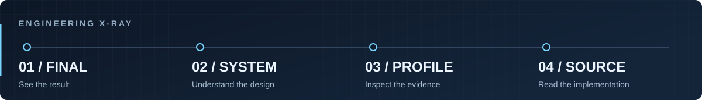

# Michał Rusinek

**Software Engineer — Unity & .NET** 
C# · Gameplay Systems · Backend Reliability

I build games in Unity and backend prototypes with .NET, PostgreSQL and Kafka. I co-created and shipped **Humanity’s Last Stand**, an Android game with **1,000+ downloads on Google Play**.

**Open to Software Engineer, Unity Developer and C#/.NET opportunities.** Based in Wrocław, Poland.

**[Portfolio](https://portfolio.michaelrusinek.workers.dev/)** · **[CV](https://portfolio.michaelrusinek.workers.dev/cv/)** · **[LinkedIn](https://www.linkedin.com/in/michaelrusinek/)** · **[Email](mailto:michael.rusinek.contact@gmail.com)**

 

## Selected work

### 01 / Humanity’s Last Stand

**Released Android game · Unity · C# · Two-person team**

A 3D aerial-combat game with enemy encounters, aircraft progression and weapon upgrades. Also known during development as **Pig Invasion**.

- **My contribution:** primary responsibility for programming and gameplay implementation, plus game design, testing, store icons and descriptions, and release preparation. My teammate focused mainly on models and assets; we developed and published the game together.
- **Result:** a public Android release with **1,000+ downloads**, as displayed by Google Play on 16 October 2026.
- **See it:** real gameplay footage and a case study covering the project’s scope and evidence.

[**Watch gameplay →**](https://portfolio.michaelrusinek.workers.dev/work/humanitys-last-stand/#project-recording) · [Google Play](https://play.google.com/store/apps/details?id=com.WPF.PigInvasion) · [Case study](https://portfolio.michaelrusinek.workers.dev/work/humanitys-last-stand/)

### 02 / Blackbox

**Backend prototype · C# · ASP.NET Core · EF Core · PostgreSQL · Kafka · Docker**

An order-workflow prototype exploring a concrete reliability problem: what happens when the database commits, but event publication fails?

- **Implementation:** workflow state and outbox records share a PostgreSQL transaction; a worker claims pending rows with `FOR UPDATE SKIP LOCKED` and publishes to Kafka.
- **Engineering detail:** the case study traces the crash window between Kafka acknowledgement and database commit. The current Inbox recognizes the same Kafka offset; logical-event deduplication and exactly-once business effects remain open work.
- **Verification record:** the 14 October 2026 local run reports **71 unit tests, 6 PostgreSQL integration tests and 32 Playwright API scenarios passing**. These are functional checks, not load-test or production-availability results.

[**Read the transaction-boundary case study →**](https://portfolio.michaelrusinek.workers.dev/notes/transactional-outbox/)

Private repository; the public article includes code excerpts, a transaction diagram, test context and trade-offs.

### 03 / Flying AI Swarm

**Public Unity prototype · C# · Jobs · Burst · Spatial Hashing**

Flying-agent behaviour with formation strategies, state machines and reusable enemy/projectile pools.

- **Inside the code:** a Burst-compiled `IJobParallelFor` evaluates flocking neighbours through a spatial hash; `FlockingSystem` manages native buffers and schedules jobs.
- **Start the review:** inspect the [flocking job](https://github.com/Mr444-dev/Unity-Flying-AI-Swarm/blob/main/Assets/Scripts/FlyingAI/Flocking/FlockingJob.cs), [formation factory](https://github.com/Mr444-dev/Unity-Flying-AI-Swarm/blob/main/Assets/Scripts/FlyingAI/Formations/FormationFactory.cs) and [object pool](https://github.com/Mr444-dev/Unity-Flying-AI-Swarm/blob/main/Assets/Scripts/FlyingAI/Pooling/ObjectPoolBase.cs).
- **Scope:** an inspectable technical prototype. Reproducible frame-time and allocation captures are still needed before quoting performance results.

[**Explore source and setup →**](https://github.com/Mr444-dev/Unity-Flying-AI-Swarm) · [Source walkthrough](https://portfolio.michaelrusinek.workers.dev/work/flying-ai-swarm/)

## Technical focus

- **Gameplay and tools:** C#, Unity, gameplay implementation, finite-state machines, formation strategies, object pooling and editor tooling.
- **Backend and data:** ASP.NET Core, EF Core, PostgreSQL, SQL transactions, Kafka, outbox/inbox boundaries and retry behaviour in portfolio prototypes.
- **Verification:** xUnit, PostgreSQL integration tests, Playwright API tests, Git and Docker Compose; test results kept separate from performance claims.

## More to explore

- [**Shared AR Workshop**](https://github.com/Mr444-dev/shared-ar-workshop) — Unity/C# AR prototype with a Node.js room relay and a recorded two-browser relay walkthrough. Physical-device AR validation remains pending.
- [**ProcureScope**](https://github.com/Mr444-dev/ProcureScope) — Python/PostgreSQL data-pipeline project with source-response archiving, record validation, dbt models and Airflow scheduling.
- [**Blackhole Simulation**](https://portfolio.michaelrusinek.workers.dev/work/blackhole-simulation/) — gravitational-visualization experiment with a real project recording.
- [**PathDrawer**](https://portfolio.michaelrusinek.workers.dev/work/pathdrawer/) — Unity trajectory-visualization tool, presented through a project capture; the original source is unavailable.

## How I explain my work

**Engineering X-Ray:** **Final** shows the result; **System** explains the design; **Profile** records measured behaviour and evidence gaps; **Source** points to code or an explicit access limitation.

I’m interested in the decisions underneath the demo: where state lives, what a retry changes, and what still needs to be measured.

**[Let’s talk about your team →](mailto:michael.rusinek.contact@gmail.com)**
